# Color themes

`SetTheme` selects a bundled palette, shared by `agg` and `asg`. The default
is `dracula`. GIF, WebP, MP4, WebM and SVG receive the same background,
foreground and 16 ANSI colors; fonts, cursor rendering and video compression
can still make the outputs look different.

```bash
SetTheme 'kanagawa'
```

The palettes are defined in `s-vhs.sh`, not selected by name in the renderer.
Names shared with agg use its 1.9.0 colors; `atom-one` uses asg 2.1.0's
palette.

## Gallery

Each recording shows the default foreground, ANSI colors 0–7 and bright
colors 8–15 as text and background swatches. The labels use explicit color
indices, not bold text. Each row shows the same recording rendered by `agg`
(GIF) and `asg` (SVG).

| Theme | GIF | SVG |
| --- | --- | --- |
| `asciinema` | 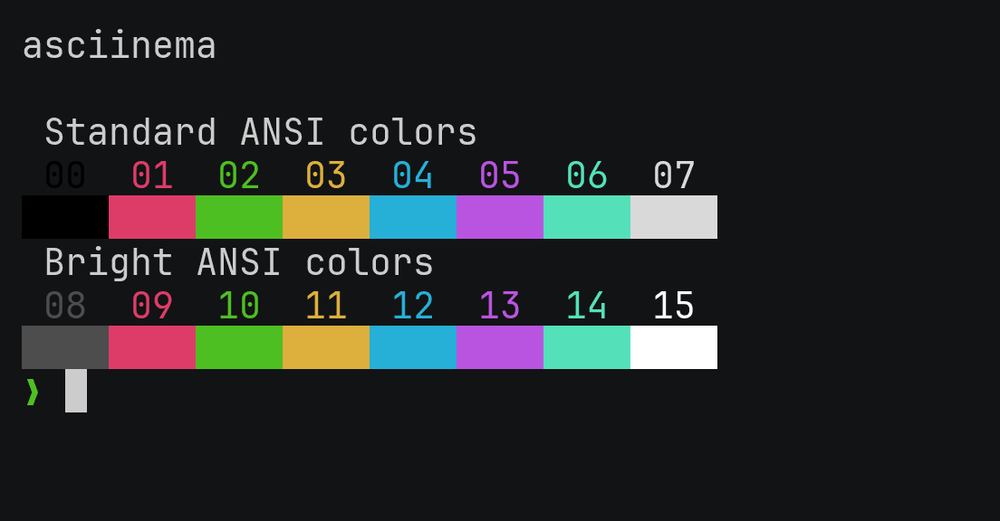 |  |
| `atom-one` |  |  |
| `dracula` (default) | 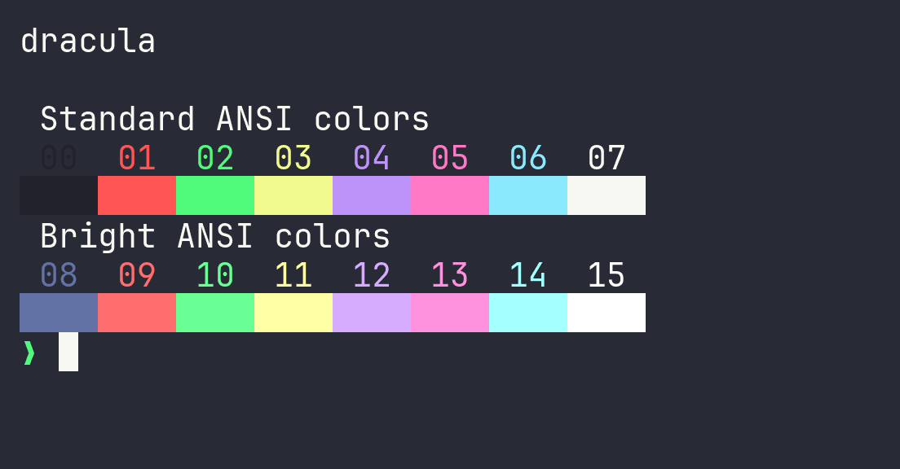 | 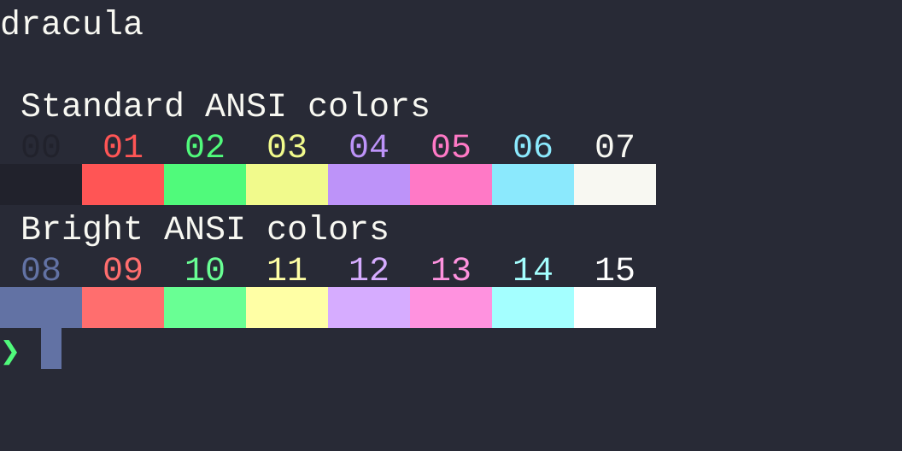 |
| `github-dark` |  |  |
| `github-light` | 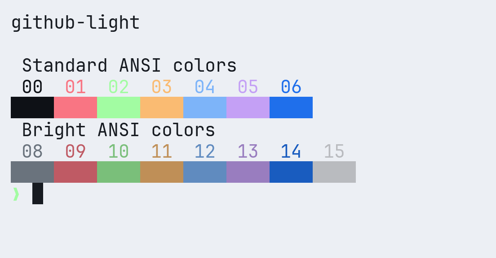 |  |
| `kanagawa` | 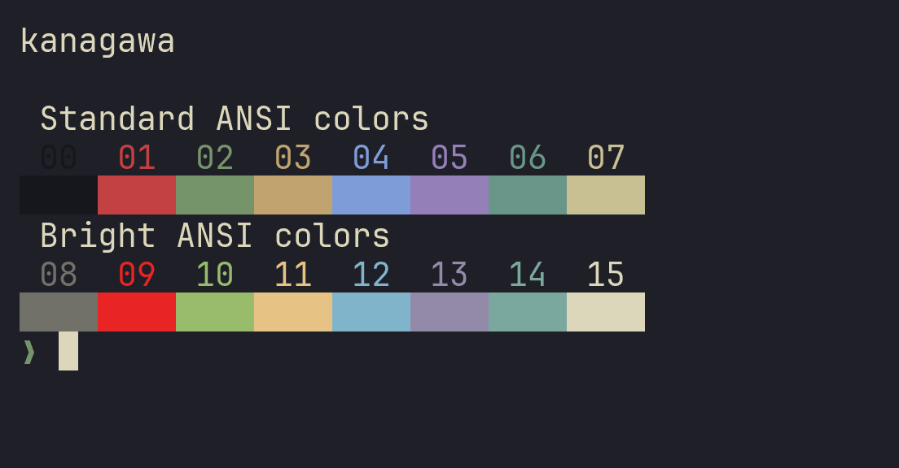 | 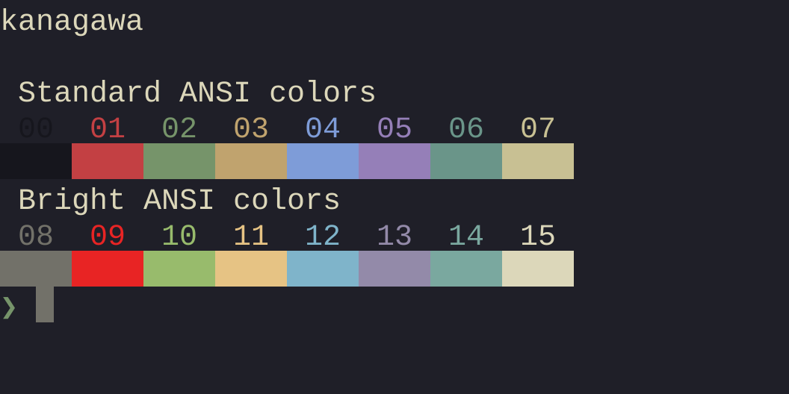 |
| `kanagawa-dragon` | 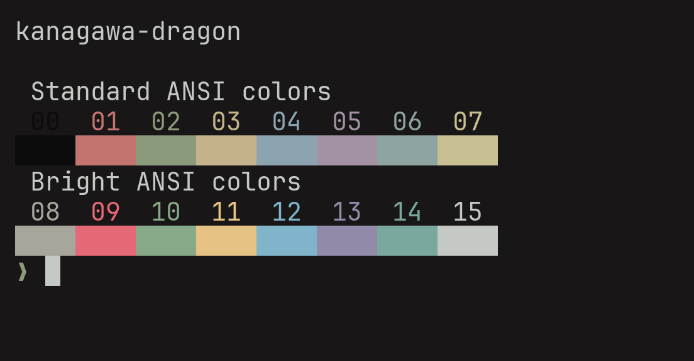 |  |
| `kanagawa-light` |  | 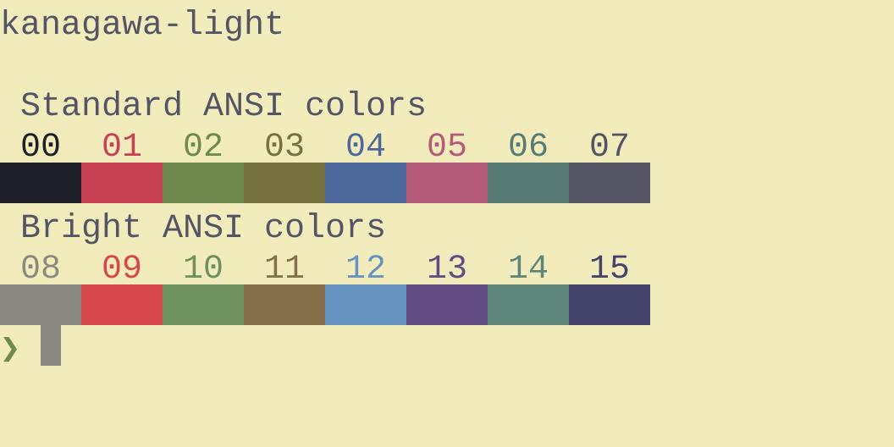 |
| `monokai` |  | 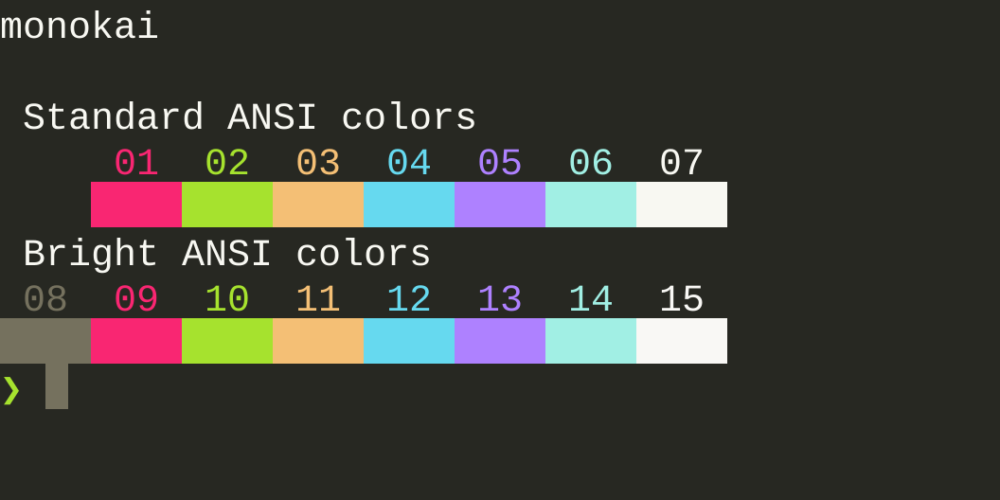 |
| `nord` |  |  |
| `solarized-dark` | 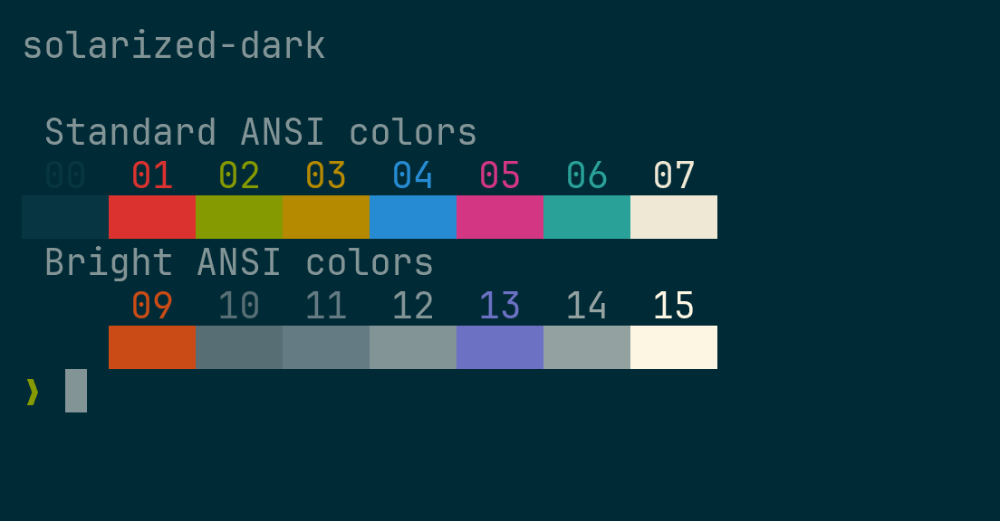 |  |
| `solarized-light` | 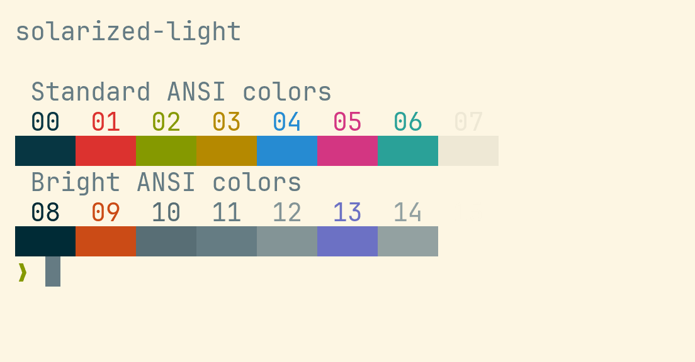 |  |

## Custom palettes and renderer-specific names

For a custom palette that works in both renderers, pass 18 comma-separated
six-digit hex colors, without `#`: background, foreground, then ANSI 0–15.

```bash
SetTheme '282a36,f8f8f2,21222c,ff5555,50fa7b,f1fa8c,bd93f9,ff79c6,8be9fd,f8f8f2,6272a4,ff6e6e,69ff94,ffffa5,d6acff,ff92df,a4ffff,ffffff'
```

Custom values and names outside the bundled list pass through unchanged.
Their syntax and availability depend on the renderer; an unsupported value
fails at `Render`. For example, agg also accepts an eight-color palette
(background, foreground, then eight colors), but asg requires all 16 ANSI
colors. `gruvbox-dark` and `svg-term` are not bundled.

These palettes affect rendering, not terminal color queries inside the
recorded session. They do not recolor explicit 24-bit colors printed by an
application or embed the chosen palette in a retained `.cast`.

## Regenerate the samples

From the repository root:

```bash
./examples/themes.rec.sh
```

The script uses the default isolated shell and renders every theme to GIF and
SVG under `examples/themes/`. It needs `tmux`, `asciinema`, `agg` and `asg`;
`gifsicle` optimizes the GIFs when installed. Liberation Mono is preferred to
keep the font's advance aligned with SVG cells; if missing, the renderers fall
back to their own fonts.
